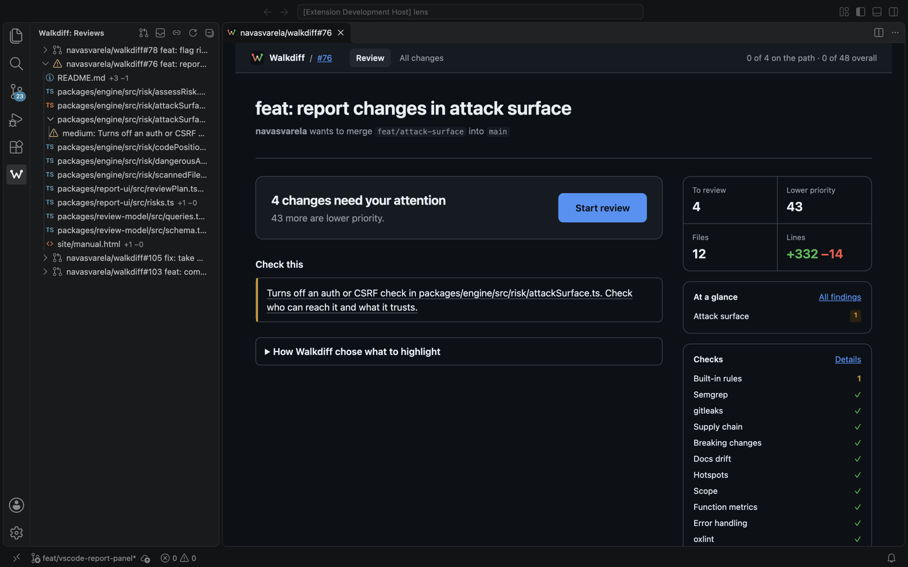
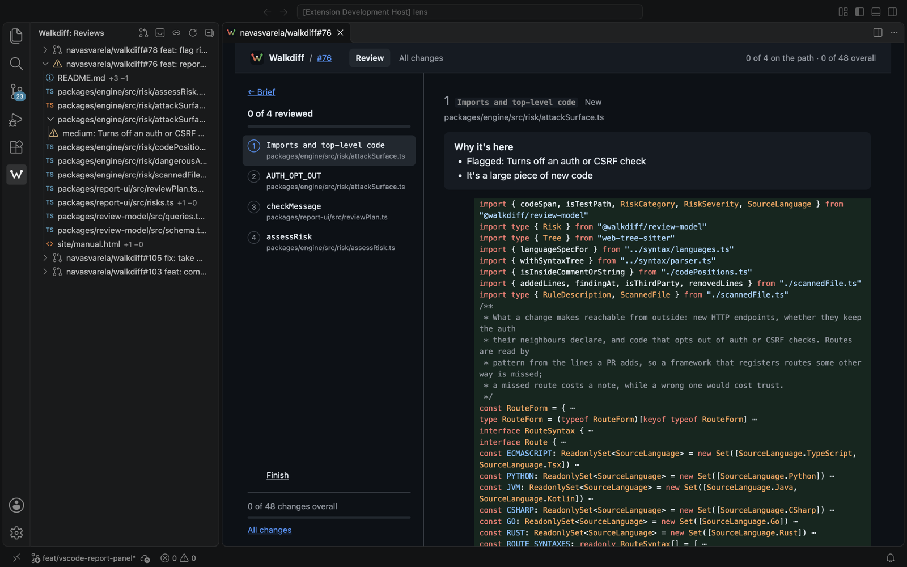
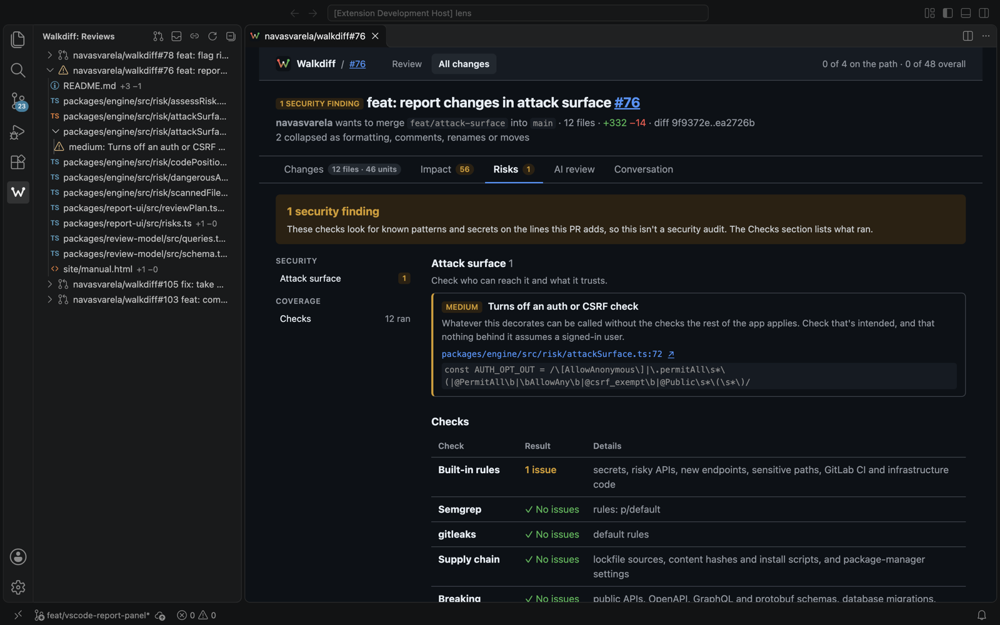
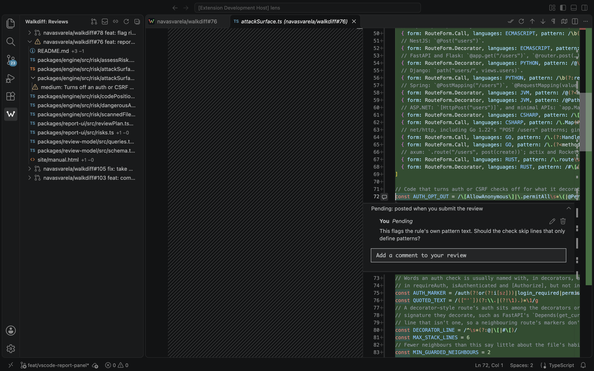

# Walkdiff for VS Code

Review GitHub pull requests and GitLab merge requests in VS Code with [Walkdiff](https://github.com/navasvarela/walkdiff): each changed function whole, where the rest of the code uses it, and what looks risky.

## What it does

**The same review as in the Walkdiff app, in a VS Code tab.** Open a review and you get its report: the brief with what to check first, the review path through the changes that matter most, all changes with where the rest of the code uses them, the risks overview, the AI review if you asked for one, and the PR's conversation, where you post your review.







- **Start a review from where you are.** Review the pull request for the branch you have checked out, pick one that's waiting for your review, or paste a link to any PR or MR on GitHub or GitLab.
- **Follow it in the Walkdiff view.** It lists your reviews with the step each analysis is on, and says when one is ready. Click a review to open its report.
- **Use the editor too.** A review in the view also lists its changed files and their findings. A file opens in VS Code's diff editor without checking the PR out, and a finding opens at its line. Comment on any line the diff shows, and post those comments with **Submit Review…**. The PR's threads appear on their lines, where you can reply and resolve.



## Posting safely

A review speaks for the commit its report was made from. If the PR gets new commits after that, Walkdiff posts nothing and asks you to analyze it again; your pending comments are kept. A pending comment whose lines are no longer in the diff after that goes in the review's text, naming the lines it was written on, rather than being lost.

In the diff editor, comments go only on lines the diff shows, as on GitHub and GitLab themselves. Threads on code that has since changed aren't on any line there; the report's Conversation tab shows them. The report and the diff editor keep their comments apart: each posts its own when you submit from it.

## How it works

Reviews run in the Walkdiff app on your machine (`npx walkdiff app`), the same one that serves the review list in your browser. The extension finds the running app from the connection file it writes, and starts it in a terminal if it isn't running. Your GitHub or GitLab login stays with the app: the extension never sees a token.

The app needs Walkdiff 0.14.0 or later, which the extension fetches from npm by default, Node.js 22.18 or later, and a login for private repositories: `GITHUB_TOKEN`, the GitHub CLI's login, or `GITLAB_TOKEN`. For GitHub Enterprise or self-managed GitLab, add the host to `WALKDIFF_TRUSTED_GITHUB_HOSTS` or `WALKDIFF_TRUSTED_GITLAB_HOSTS`, as the [configuration guide](https://github.com/navasvarela/walkdiff/blob/main/docs/configuration.md) describes.

## Settings

| Setting | Default | Meaning |
| --- | --- | --- |
| `walkdiff.command` | `npx --yes walkdiff@latest` | How the extension runs Walkdiff when it starts the app: `<command> app --no-open`. Use `walkdiff` if you installed it yourself |
| `walkdiff.dataDir` | empty | The app's data directory, if you start it with `--data-dir` |
| `walkdiff.aiReview` | `false` | Ask for the AI review too, if the app has one set up |

`walkdiff.command` and `walkdiff.dataDir` can only be set in your user settings, not a workspace's, so a repository you open can't change what runs.

## Developing

From the repository root:

```sh
pnpm install
pnpm build:ui
pnpm build:vscode
code --extensionDevelopmentPath="$PWD/packages/vscode"
```

To install a build in your own VS Code, package it and install the `.vsix`:

```sh
pnpm --filter walkdiff-vscode package
code --install-extension packages/vscode/walkdiff-vscode-0.2.0.vsix
```

The extension is bundled into `dist/extension.cjs` with rolldown. Building it also writes `dist/report.html`, the report UI the app serves, which the report panel fills with each review; run `pnpm build:ui` first. The panel's page has no key: it posts each call to the app to the extension, which passes on only the ones its review needs. The extension's logic that doesn't need VS Code (the connection file, the API client, the report page and the calls it may make, the rows of the reviews view) has unit tests that run with the rest: `pnpm test`. The app's API is described in [docs/app-api.md](https://github.com/navasvarela/walkdiff/blob/main/docs/app-api.md).
